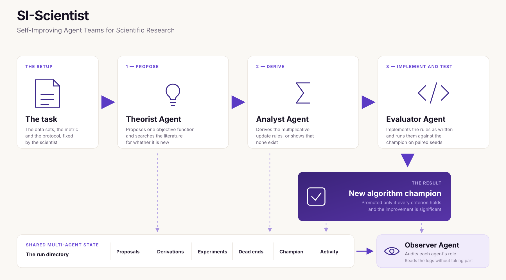

# SA-Scientist: Self-Adaptive Agent Teams for Scientific Research

SA-Scientist is a multi-agent LLM team for algorithm discovery, based on:

> Tolic, D., Antulov-Fantulin, N. & Kopriva, I.
> A nonlinear orthogonal non-negative matrix factorization approach to subspace clustering.
> *Pattern Recognition* **82**, 40–55 (2018).
> [doi:10.1016/j.patcog.2018.04.029](https://doi.org/10.1016/j.patcog.2018.04.029)

---


## Agent architecture

The team has four agents: a Theorist, an Analyst, an Evaluator and an Observer. They run one at a
time and exchange information only through files in a shared run directory. 

### Theorist agent

The Theorist reads the current champion algorithm, the dead-end log and the experiment log. It then:

- **Proposes** one new objective function. For each term, it states where the term comes from,
  which term balances it, and the value of any new coefficient.
- **Checks novelty** by searching the literature. It classifies the proposal as *novel*,
  *published* or *adjacent* (published in a different setting), and records the search queries.

### Analyst agent

The Analyst derives multiplicative update rules for the proposed objective. The derivation consists
of the Lagrangian, the partial derivatives with every product Φᵀ(X)Φ(X) replaced by the kernel
matrix K, the Karush–Kuhn–Tucker (KKT) conditions, and the separation of each gradient into a
positive and a negative part. The resulting rules are written as pseudocode.

If a gradient cannot be separated into non-negative parts, no multiplicative update exists. The
Analyst then records a refusal.

### Evaluator agent

The Evaluator implements the pseudocode, evaluates it on all data sets with a single call to
`evaluate_algorithm`, and records both the result and the random seed in `logs/experiments.jsonl`. It
then applies the promotion rule.

### Observer agent

The Observer reads all logs and writes an audit of the run: what was proposed, derived, refused and
evaluated, and whether each agent stayed within its role. It reports first
any proposal that improved accuracy but failed a theoretical criterion.

### The loop

```
Theorist         proposes an objective, establishes novelty
    |
Analyst          derives the update rules, writes pseudocode
    |
Evaluator        implements, evaluates, logs, applies the gate
    |
Observer         audits the run
    |
next cycle       the Theorist reads the champion, promoted or not
```

In each cycle, every agent first checks whether it has work. An agent with no work exits.

---

## The protocol parameters

The evaluation protocol is defined in `task-nmf/TASK.md`:

- `alpha`, `mu`: the weights of the reconstruction and orthogonality terms in the champion's
  objective
- `n_restarts`: the number of random initialisations; `seed`: the seed of the first initialisation
- `max_iter`, `kappa`: the maximum number of iterations and the tolerance of the stopping rule
- `sigma_grid`: the kernel widths searched for each data set

Agents do not choose or tune these parameters. To change the protocol, edit `TASK.md`.

---

## The theoretical criteria

Every evaluated rule is checked against theoretical criteria on every restart:

- **Non-negativity:** the factor matrices H and F stay non-negative. The multiplicative form of the
  updates guarantees this when the derivation is correct.
- **Monotonicity:** the objective does not increase from one iteration to the next.
- **Finiteness:** no entry becomes infinite or NaN.

Monotonicity is checked numerically on the objective that the Analyst supplies, so the same check
applies to any proposal.

A proposal becomes the new champion if all three criteria hold on every restart of every data set
and its accuracy is significantly higher than the champion's (paired test over the same
initialisations, p < 0.05). Each algorithm selects its own kernel width. A proposal that fails a
criterion is not promoted, even if its accuracy is higher. It is recorded in the dead-end log under
the name of the failed criterion.

---

## Quickstart

Requires numpy and scipy.

```
python3 selftest.py          # test the code
python3 test_promotion.py    # test champion promotion
python3 launch.py my-run
cd ../my-run
# then follow runbook.md
```

`selftest.py` checks the environment, checks that the protocol is implemented as specified, and
checks that the scorer rejects rules that fail a criterion.

`launch.py` creates a self-contained run directory. It contains copies of the system files, the
scorer, the data, the champion and the task, and one instruction file per agent,
`HEARTBEAT-<role>.md`, which combines the shared instructions with the instructions for that role.

`runbook.md` contains the instructions for the orchestrator, the session that starts the four
agents in order and checks the exit condition.

To evaluate the champion without running the agents, run this from a run directory:

```python
from system.helper import FolderState
from scorer.run_algorithm import evaluate_algorithm, load_champion

meta, _ = FolderState(".").read_task()
champion = load_champion()
result = evaluate_algorithm(champion.UPDATE, champion.OBJECTIVE, task_meta=meta, paired=False)
print(result["accuracy"])
```

---

## The champion

`champion/algorithm.py` contains the code of the current best algorithm: an `update` function and an
`objective` function. When a proposal is promoted, its code replaces this file.
`champion/champion.json` contains the objective of the current champion and the derivation of its
update rules. The Theorist reads both files before proposing a change.

The initial champion algorithm is kernel non-negative spectral clustering with the ratio cut (KNSC-Rcut). The
file also contains the normalized-cut version (KNSC-Ncut) for reference.

---

## Data

Datasets are CSV files with a header row, one point per row and the class label in the last
column. After loading, points are stored as columns, so X has size m × n for m dimensions and n
points.

`TASK.md` declares two data sets in the plane: the synthetic dataset used in the published
experiments, and two interleaved half-circles generated from a fixed seed. 

The six real data sets used in the original paper are available from the [UCI Machine Learning
Repository](https://archive.ics.uci.edu/) and through [OpenML](https://www.openml.org/).

---

## Layout

```
selftest.py                verify the code
test_promotion.py          verify champion promotion
launch.py                  create a run directory
runbook.md                 instructions for the orchestrator
LAUNCH.md                  settings: cycle order, promotion, exit condition
system/helper.py           shared state
system/templates/          HEARTBEAT + the four role files
scorer/run_algorithm.py    evaluates one proposed algorithm
scorer/knsc.py             kernel, degree matrix, cluster labels, accuracy
scorer/datasets.py         data loading
champion/                  the current best: its code and its record
task-nmf/TASK.md           the protocol
data/                      clustering data sets
```

---

## Extensions

Extensions: the concurrent configuration in which several agents deliberate over the same task across long horizons.
